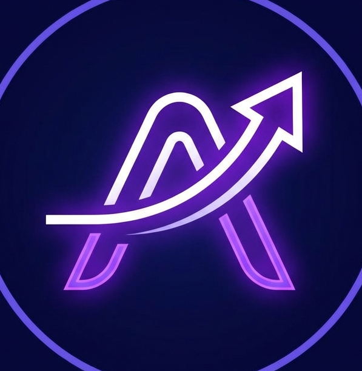
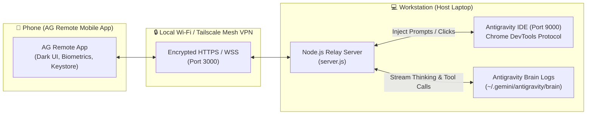

<div align="center">
  
  <h1>AG Remote Relay Server 📱🚀</h1>
  <p><strong>Secure HTTPS / WSS Relay Bridge for the "AG Remote: AI Coding Companion" Mobile App</strong></p>
</div>

[](https://www.gnu.org/licenses/gpl-3.0)
[](https://nodejs.org/)
[](#security-architecture)

---

## 📖 Overview

The **AG Remote Relay Server** provides a secure, encrypted real-time bridge between your desktop workstation running **Google Antigravity** and your mobile phone running the **AG Remote: AI Coding Companion** app.

Whether connected over **Local Wi-Fi** or remotely via **Tailscale Private Mesh VPN (5G / Cellular)**, this relay enables full remote control, prompt generation, interactive action reviews (Allow / Reject), and instant browsing of your complete conversation history directly from your phone.

---

## ✨ Key Features

- **🔌 Chrome DevTools Protocol (CDP) Bridge**: Connects directly to Antigravity's active execution context on port `9000` to inject prompts, click review buttons, and manage models.
- **⚡ Live Transcript Streaming (WebSocket)**: Automatically watches local Antigravity JSONL logs (`~/.gemini/antigravity/brain`) for file changes, streaming AI thinking, tool executions, and responses in sub-100ms real time.
- **🔄 Dual-Sync Conversation Switching**: Switch past sessions from the phone drawer; the relay automatically brings that exact chat forward on your desktop screen simultaneously.
- **🔒 Enterprise Security**:
  - Encrypted TLS/HTTPS & WSS.
  - Brute-force rate limiting on `/login` (`express-rate-limit`).
  - High-entropy cryptographic secrets (`SESSION_SECRET`, `AUTH_SALT`).
  - Zero open internet ports required when paired with Tailscale WireGuard.

---

## 🏗️ Architecture



---

## 🚀 Quick Setup Guide

### 1. Prerequisites
- **Node.js**: v18.0.0 or later ([Download Node.js](https://nodejs.org/))
- **Google Antigravity**: Installed and running on your host system
- *(Optional for 5G access)* **Tailscale**: For secure peer-to-peer VPN without port-forwarding ([Download Tailscale](https://tailscale.com/))

---

### 2. Installation & Configuration

1. **Clone the repository**:
   ```bash
   git clone https://github.com/sumitchourasiya/antigravity-relay-server.git
   cd antigravity-relay-server
   ```

2. **Install dependencies**:
   ```bash
   npm install
   ```

3. **Set up Environment Variables**:
   Copy `.env.example` to `.env`:
   ```bash
   cp .env.example .env
   ```
   Configure your `.env` file:
   ```env
   # Security Passcode for mobile app login
   APP_PASSWORD="YourStrongPasswordHere#"

   # Server Port
   PORT=3000

   # High-entropy cryptographic secrets
   SESSION_SECRET="generate-any-32-char-random-string"
   AUTH_SALT="generate-any-32-char-random-string"

   # Authentication policy
   REQUIRE_AUTH_LAN=false
   ```

4. **Generate SSL Certificates**:
   ```bash
   node generate_ssl.js
   ```
   *(This generates local self-signed certificates in `./certs` for HTTPS and WSS support).*

---

### 3. Launching the System

#### Step A: Launch Antigravity in Debug Mode
Antigravity must be launched with remote debugging enabled on port `9000`:

- **Windows**:
  ```powershell
  & "$env:LOCALAPPDATA\Programs\Antigravity\Antigravity.exe" --remote-debugging-port=9000
  ```
- **macOS**:
  ```bash
  /Applications/Antigravity.app/Contents/MacOS/Antigravity --remote-debugging-port=9000
  ```
- **Linux**:
  ```bash
  antigravity --remote-debugging-port=9000
  ```

#### Step B: Start the Relay Server
```bash
node server.js
```
*Or on Windows, simply double-click `start_ag_phone_connect.bat`.*

You will see:
```text
🔍 Discovering Antigravity CDP endpoint...
Found Antigravity IDE target: ...
✅ Found Antigravity on port 9000
🔌 Connecting to CDP...
✅ Connected! Found 2 execution contexts

======================================================
🚀 Antigravity Phone Connect running on:
   🏠 Local Wi-Fi:             https://192.168.1.21:3000
   🔒 Tailscale (Remote/5G):   https://100.90.214.98:3000
======================================================
```

---

## 📱 Next Steps to Perform in the Mobile App

Once the Relay Server is running, connect your mobile app:

### Step 1: Install "AG Remote" on Your Phone
Install **AG Remote: AI Coding Companion** on your phone from the Google Play Store (or install the pre-built APK).

### Step 2: Accept the Self-Signed Certificate
Because the relay uses self-signed HTTPS for local encryption:
1. Open Chrome or Safari on your phone.
2. Navigate to your relay URL (e.g. `https://192.168.1.21:3000` or your Tailscale IP `https://100.x.y.z:3000`).
3. Tap **Advanced** ➔ **Proceed to site (unsafe)** to establish browser certificate trust.

### Step 3: Connect & Pair in the App
1. Launch **AG Remote** on your phone.
2. Enter the **Server URL**:
   - On the same Wi-Fi network: `https://192.168.1.21:3000`
   - On mobile data (5G/4G via Tailscale): `https://<tailscale-ip>:3000`
3. Enter the **Passcode** configured in your `.env` (`APP_PASSWORD`).
4. Tap **Connect & Pair**.
5. Once paired, enable **Biometric Unlock (Fingerprint / Face)** for instant future access.

### Step 4: Using Mobile Features
- **Auto-Scroll to Bottom**: The chat opens directly scrolled to the latest message.
- **Scroll-to-Bottom Floating Button**: When scrolled up to read past history, tap the floating downward arrow button (`↓`) in the bottom-right corner to jump back to the latest message.
- **Previous Chat Drawer (Dual-Sync)**: Tap the hamburger icon (☰) on the top-left to browse and search all past conversations. Selecting any session updates both your phone and your desktop Antigravity IDE simultaneously.
- **Sending Prompts**: Type your message in the bottom input bar and tap send. Thoughts, tool invocations, and answers stream onto your screen in real time!

---

## 📄 API Reference

| Endpoint | Method | Description |
|---|---|---|
| `/login` | `POST` | Authenticate with `password`, issues signed HTTP-only cookie |
| `/health` | `GET` | Server status and `cdpConnected` boolean flag |
| `/chat-history` | `GET` | List all past conversation summaries and metadata from `brain` |
| `/transcript` | `GET` | Get structured messages (user, model, thinking, toolCalls) for current chat |
| `/transcript/:id` | `GET` | Get structured messages for a specific conversation by ID |
| `/send` | `POST` | Inject prompt into Antigravity IDE (`{ message: string }`) |
| `/remote-click` | `POST` | Click interactive UI buttons (Allow, Reject, Review) |
| `/select-chat` | `POST` | Switch active desktop conversation via CDP (`{ title: string }`) |
| `/stop` | `POST` | Stop active generation in Antigravity |
| `/ws/stream` | `WSS` | Live WebSocket streaming for transcript updates and snapshots |

---

## 🛡️ License

This project is licensed under the [GNU General Public License v3.0](LICENSE).
